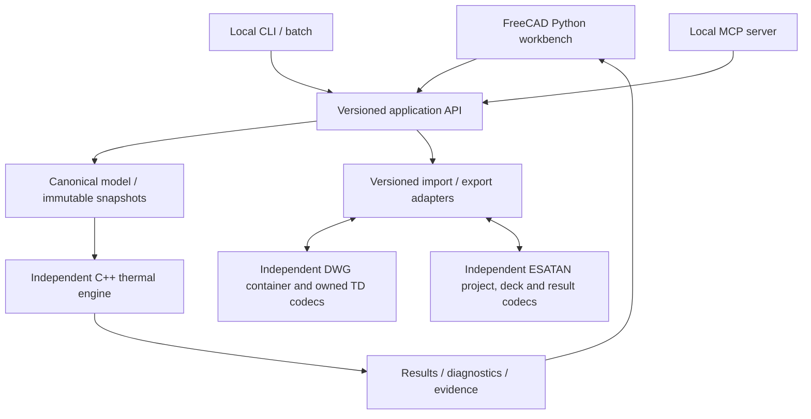

# FreeCAD Space Thermal

## 1. Document control and decision

| Field | Baseline |
|---|---|
| Document | FCST-SYS-SPEC-001 |
| Revision | 0.9 — independent TD and ESATAN import and export |
| Prepared | 2026-10-27 |
| Product name | FreeCAD Space Thermal (FCST), working name |
| User decisions | Open-source add-on and independently maintained C++ engine; Python integration; existing solvers may be starting points; local-first; equal priority for Thermal Desktop and ESATAN-TMS; NASA/ESA refers to existing-tool file compatibility |
| Intended audience | Thermal analysts, implementation engineers, and software testers |
| Current evidence | Design and implemented foundation/SINDA subset; independent DWG thermal codecs and production solver unimplemented |
| Change owner | Product owner for scope; thermal and software leads for numerical and compatibility test criteria |

**Decision:** implement an independently maintained **C++ numerical engine**, with **Python for FreeCAD integration, automation/MCP, tests, and reference prototypes**. A versioned application/model/job interface connects these components and permits other front ends. Rust remains an optional implementation experiment; it is not a required production dependency. The default implementation is C++ unless the Q0 comparison checkpoint produces evidence for an explicitly accepted change.

**Solver ownership decision:** the production target is our own independently maintained thermal engine. PyCanha and other solvers may inform implementation, provide compatible reusable code/components, generate comparison cases, or run temporary prototypes. A permanent wrapper around another solver is not the target. The owned engine must execute the required supported physics after model import, without delegating the solve to PyCanha, SINDA, ESATAN, or another external thermal solver. Low-level numerical libraries, meshers, and documented property libraries remain permitted dependencies.

**Native creation and file independence:** FCST must also create models from scratch, save them in its own versioned `.fcst` project format, reopen and edit them, solve them with the owned engine, and inspect results without an imported vendor model, proprietary thermal/CAD runtime, vendor license, or vendor service. Thermal Desktop and ESATAN backward compatibility is an additional required adapter capability. The legacy-model inventory defines compatibility coverage; it is not a prerequisite for native authoring or solving. This clarification applies to ARC-001, ARC-003, ARC-009 and the native persistence/installation acceptance workflows.

**Legacy file independence:** TD/SINDA and ESATAN native-project, network and result import, edit, export and reopen must also work with Thermal Desktop, OpenTD, AutoCAD/CRTechCAD, SINDA/FLUINT, ESATAN-TMS/ESARAD, their APIs, licenses and conversion services absent. A prior source-tool conversion is not a prerequisite. Use independent file readers/writers and owned versioned thermal codecs. The [independent TD exchange decision](../docs/decisions/0004-independent-thermal-exchange.md) and [independent ESATAN decision](../docs/decisions/0005-independent-esatan-exchange.md) supersede mandatory vendor API/export migration paths. Existing OpenTD code is optional external reference tooling only; full direct DWG thermal conversion remains unimplemented.

**Primary benchmark/starting-point references:** SINDA/FLUINT and Thermal Desktop shall guide required thermal/fluid model behavior, source-model semantics, analyst workflows, and comparative benchmark cases. Existing ESATAN-TMS compatibility remains equally required. For proprietary products, a starting point means documented methods and interfaces, modeling concepts, authorized model fixtures and reference runs; source-code reuse applies only where the code is actually available under suitable terms. PyCanha and other open implementations remain additional adoption/reference candidates.

Naming: **FLUINT** is the fluid-network solver paired with SINDA and used with Thermal Desktop; **Ansys Fluent** is a separate CFD product. This specification uses SINDA/FLUINT for the primary suite and retains Fluent as an optional CFD/conjugate-heat-transfer comparator where useful, without adding universal Fluent-file compatibility or a full CFD solver requirement. [S13, S23, S24]

The end-state requirement is backward compatibility with existing Thermal Desktop and ESA-tool models. That requirement is made testable through a controlled legacy-model inventory, explicit source-version profiles, semantic coverage reports, and execution/re-export qualification. A universal claim covering every historical proprietary file cannot be made before those profiles and fixtures are tested. Unsupported required models block the corresponding release; they are not silently removed from scope.

**Scope clarification:** NASA/ESA refers to the thermal-analysis tools and existing files used by their teams. The requirement is to open, preserve, edit, run, and exchange those models as specified below. Agency certification, standards compliance, software-assurance classifications, clause-by-clause audits, and formal authority sign-offs are outside this product scope. Numerical checks and file round-trip tests remain ordinary engineering acceptance criteria because they establish whether conversion and solving work correctly.

Revision 0.2 removes the agency-governance requirements introduced in revision 0.1. Retired requirement IDs GOV-001, GOV-004, GOV-005, GOV-007, and VNV-008 are not reused. File-format specifications remain technical implementation references, not agency process obligations.

Revision 0.3 resolved native-versus-bridged execution in favor of the owned solver. Its allowance for mandatory TD APIs during extraction/migration/re-export is superseded by revision 0.8; vendor tools may now supply optional external comparison evidence only for the TD path.

Revision 0.4 explicitly adds SINDA/FLUINT and Thermal Desktop as required benchmark and behavioral starting-point references, alongside the owned Rust solver direction.

Revision 0.5 replaces the earlier Rust-first implementation choice with a C++ solver and Python integration baseline. Solver ownership, native execution, backwards compatibility, and AI automation requirements remain in force. The language comparison checkpoint evaluates integration and numerical behavior before expensive modules are locked in.

Revision 0.6 adopted Windows-only development and Q0/P0/Q1/Q2 delivery with a scheduled platform-port follow-on. Revision 0.7 supersedes that follow-on commitment with optional stretch goals. WP-01 closes on the acquired inventory and explicit gaps; licensed reference access and complete compatibility/schema qualification remain obligations of the affected later packages. This is a FreeCAD add-on/workbench with a standalone engine, not a modified FreeCAD distribution.

Revision 0.7 removes the previously numbered port package and POST-Q2 gate. Optional macOS/Linux configurations are stretch goals, not committed delivery work. Windows Q0/P0/Q1/Q2 acceptance and the completed WP-01 baseline remain unchanged.

## 2. Purpose, users, and scope

The product shall support spacecraft and instrument thermal model creation, conduction and radiation analysis, orbital/environmental loading, test correlation, uncertainty studies, model exchange, and reviewable reporting within FreeCAD. Analysts shall be able to use abstract thermal networks, parameterized finite-difference surfaces/solids, and supported finite-element discretizations in one controlled analysis project.

Primary workflows:

1. Build a new thermal model from scratch as a geometry-free network or from FreeCAD geometry/imported mechanical CAD; save, reopen, edit and solve its own `.fcst` project using the owned engine without vendor thermal software.
2. Open an existing Thermal Desktop or ESATAN-TMS model package, inspect conversion fidelity, edit supported entities, solve, compare, and return a validated derivative to the source ecosystem.
3. Exchange GMM, TMM, and applicable results with European thermal tools using the required STEP-TAS datasets and vendor-specific adapters.
4. Predict and correlate thermal-balance/TVAC tests, retaining the original and correlated baselines.
5. Use an AI assistant for authorized model editing, review, setup, execution, and reporting through typed operations.
6. Run the same project locally in the GUI, in batch, or in an automated verification campaign without an AI provider.

Definitions:

- **GMM:** geometrical mathematical model for radiation/environmental calculations.
- **TMM:** thermal mathematical model: nodes, properties, conductors, loads, logic, and cases.
- **Mechanical CAD:** manufacturing/design geometry; does not by itself define either GMM or TMM.
- **Native execution:** the independent FCST engine, implemented in C++ by default, executes all required semantics.
- **Bridged execution:** an explicitly selected external solver executes preserved semantics for prototyping, comparison, or an optional fallback; it does not satisfy owned-engine completion.
- **Owned engine:** our independently maintained solver, with controlled model semantics, physics assembly, solving workflow, and tests; compatible third-party code and lower-level numerical libraries may be reused.
- **Source round trip:** source package → FCST → source-tool derivative → source-tool reopen/run and comparison.
- **Cross-tool exchange:** TD → FCST → ESATAN, or the reverse; distinct from a source round trip.
- **Qualification:** the product's test evidence for a declared configuration and compatibility profile; this term does not mean agency certification.

No automatic equivalence is assumed between CAD faces, radiation facets, thermal nodes, and conduction elements. Existing FreeCAD FEM infrastructure is reusable, but it does not by itself implement a Thermal Desktop/RadCAD/FloCAD-equivalent suite. [S13, S14]

The [FEM reuse decision and acceptance plan](../docs/decisions/0003-freecad-fem-reuse.md) requires a component-level assessment before overlapping host/mesh implementation. [WP-05.5](../plans/WP-05.5-Foundation-Reconciliation.md) now owns the missing foundation inventory, probes, versioned mesh/field contracts and storage handoff before dependent acceptance; completed baseline evidence retains its original scope. Prefer compatible FEM mesh, assignment/selection and result APIs through the host adapter; document evidence before replacing them. Qualify exact APIs, units, identity mappings, dependency licenses and unattended behavior against the pinned host. This is planned reuse evaluation, not an implemented FEM integration. Standalone engine independence does not preclude host-side reuse; external solver comparisons remain separately labeled and cannot qualify the owned engine.

## 3. Compatibility and product acceptance baseline

At Gate Q0, freeze the acquired sample inventory, known source-version observations and explicit owned gaps for missing versions, dependencies, results and schemas. WP-01 acceptance covers that acquired baseline. Complete source runtime/dependency and schema/reference qualification is required by the affected Q1/Q2 compatibility profiles, not by native Q0 development. Changing a supported format or source version requires the relevant regression tests.

STEP-TAS documentation, including ECSS-E-ST-31-04C, is used solely to understand the exchange format. Support is driven by entities and dataset types needed by the real files. This specification does not require a separate agency conformance program or blanket implementation of every STEP-TAS class. [S06]

### 3.1 Product acceptance requirements

Tables throughout this document form the product requirement register. **Shall** is mandatory for the indicated release gate; **should** is a recommendation; **may** is optional. `P` means a product design requirement. References identify technical sources. Verification: `T` test, `A` analysis, `I` inspection, `D` demonstration.

| ID | Requirement | Verification / acceptance | Basis | Gate |
|---|---|---|---|---|
| GOV-002 | Each model shall retain units, assumptions, source-tool/version information, and known conversion or solver limitations. | I/T: these fields survive save/reopen and appear in diagnostic reports. | P | Q1 |
| GOV-003 | Numerical and compatibility comparison tolerances shall be specified before regression runs and versioned independently of results. | I/T: changing a tolerance marks previous pass/fail results for reassessment. | P | Q1 |
| GOV-006 | Each release requirement shall link to its implementation test or demonstration and any known defect affecting it. | I: claimed compatibility features have reproducible test results. | P | Q1 |

## 4. Architecture and technology boundaries

Components and responsibilities:

| Component | Responsibilities | Explicit boundary |
|---|---|---|
| FreeCAD workbench | Commands, selection, model tree, editors, visualization, document integration | No solver-specific physics hidden in UI callbacks |
| Application service | Validation, revisions, transactions, jobs, capabilities, permissions, diagnostics | Same operations for humans, CLI, and AI |
| C++ core | Canonical model, units, thermal assembly, radiation, integration, sensitivity, result computation | No dependency on FreeCAD GUI or object pointers |
| C++ worker | Isolated job execution, resource limits, checkpoints, progress | CPU reference implementation is independently testable |
| Exchange adapters | Syntax parsing, semantic mapping, conversion plans, source re-export | No silent approximation or code execution |
| Vendor sidecars | Source-file extraction/migration/re-export and separately labeled reference/prototype runs | Separately installed runtime; cannot substitute for owned-engine completion |
| Results/reporting | Comparisons, correlation, conversion reports and test results | Raw data and pass/fail criteria are preserved separately |
| MCP gateway | Typed AI-facing tools and resources | Thin wrapper over the application API |

The default deployment uses a standalone C++ executable launched by the Python adapter or CLI, with framed local IPC and a versioned control protocol. Bulk numerical payloads travel by content-addressed local artifacts; they are not JSON-serialized one element at a time. The Python layer handles FreeCAD commands, model preparation, MCP, test orchestration and reporting; per-node, per-element, per-ray and repeated solver kernels belong in compiled code or vectorized numerical libraries.

An optional in-process Python binding may expose the C++ library through pybind11, with the embedded Python ABI, platform and memory ownership tested separately. This is an optimization path rather than a prerequisite for the initial isolated worker. A narrow C ABI may support other languages or approved user routines. Rust experiments may use the same application protocol or an audited C interface; no C++/Rust pointer ownership is passed across the normal process boundary. FreeCAD custom objects remain in its Python/host layer. [S14, S29]

| ID | Requirement | Verification / acceptance | Basis | Gate |
|---|---|---|---|---|
| ARC-001 | Workbench and owned C++ engine shall be open source; ordinary modeling and native solving shall require no proprietary CAD runtime. | I/D: clean offline installation opens, creates, and solves a native project. | User P | Q1 |
| ARC-002 | GUI, CLI, and MCP shall call the same versioned application operations and enforce the same model invariants. | T: equivalent operation sequences produce identical canonical model hashes. | P | Q1 |
| ARC-003 | The independent numerical engine shall run without FreeCAD or a Python interpreter installed, using immutable typed model snapshots. | T: headless native reference suite on an engine-only installation. | P | Q1 |
| ARC-004 | FreeCAD document and GUI mutations shall occur on the owning application thread; long work shall execute asynchronously. | T: cancellation, concurrent viewing, and worker completion do not corrupt a document. | P | Q1 |
| ARC-005 | IPC shall pass values, identifiers, and artifact references rather than FreeCAD/C++ object pointers. | I/T: schema validation and restart/replay tests. | P | Q1 |
| ARC-006 | Adapter, solver, project schema, and application API versions shall be negotiated and recorded; incompatible major versions shall fail explicitly. | T: version mismatch returns an actionable diagnostic before mutation. | P | Q1 |
| ARC-007 | The FCST CPU reference implementation shall run without a GPU; accelerated owned-engine backends shall pass independent equivalence tests. | T: supported-platform native suite; GPU implementation separately listed if shipped. | P | Q1 |
| ARC-008 | Job crashes shall be isolated from FreeCAD and leave the last committed project revision recoverable. | T: terminate workers during import, radiation, solve, and export. | P | Q1 |
| ARC-009 | The primary production solver shall be an independently maintained C++ engine owning thermal model assembly, physics semantics, steady/transient solution orchestration, and result diagnostics. | I/T: required core fixtures solve with external thermal solvers absent; another language requires the documented Q0 decision process. | User | Q1 |
| ARC-010 | Adopted open-source solver code/components shall have recorded provenance, compatible licensing, maintainable interfaces, and independent regression tests. | I/T: component inventory identifies retained/reworked code and its tests; no unsupported ownership or licensing claim. | User P | Q1 |
| ARC-011 | PyCanha and other external thermal solvers shall be optional reference/prototype backends; their successful runs shall not count as owned-engine acceptance results. | T/I: run records identify the actual backend and gate evaluation rejects substituted external runs. | User | Q1 |
| ARC-012 | Canonical models, UI commands, and MCP operations shall remain backend-independent while exposing the actual solver identity and capabilities. | T: a reference backend can be removed without changing the native model format or mislabeling results. | P | Q1 |
| ARC-013 | Before numerical interfaces freeze, the project shall record a prototype-based C++ suitability assessment and, when testing Rust as a challenger, use the same snapshots, numerical backend, tolerances, hardware and comparison criteria. | T/A: correctness, convergence, event/energy error, runtime, memory, implementation effort and Windows packaging evidence recorded; C++ remains the default unless an explicit decision changes it. | User P | Q0 |
| ARC-014 | Low-level numerical and ray-intersection dependencies shall sit behind owned-engine interfaces and shall not replace FCST thermal/radiation model semantics or acceptance tests. | I/T: dependency versions, capabilities and licenses recorded; native analytic/source-comparison cases pass. | P | Q1 |
| ARC-015 | Python shall provide FreeCAD integration and automation/test orchestration while the compiled engine owns repeated performance-critical physics kernels. | T/I: engine-only operation and Python GUI/CLI/MCP tests agree; profile representative workloads before moving additional code across the boundary. | P | Q1 |

### 4.1 Development approach for the owned engine

1. Define the canonical thermal model, units, stable identifiers, application API, and benchmark harness before selecting reusable solver components.
2. Start from SINDA/FLUINT and Thermal Desktop's documented modeling behavior, source-file semantics, analyst workflows and reference cases; also evaluate PyCanha and other open implementations for parser components, numerical methods, and appropriately licensed code. Reuse useful work with attribution; ownership means we maintain the resulting engine and its behavior, not that every numerical primitive must be rewritten.
3. Complete the Q0 numerical/language checkpoint, then implement and verify C++ conduction/storage assembly, boundary and algebraic nodes, steady solving, stiff transient integration, temperature-dependent properties, and heater events.
4. Implement radiation geometry/exchange and environmental loading with independent analytic/refinement tests, followed by coupled native thermal solves.
5. Translate each required imported source feature into owned-engine semantics and compare against analytical cases and the relevant source solver. Source-solver agreement supplements rather than replaces independent correctness checks.
6. Close the required legacy corpus on the owned engine. External solver fallbacks stay explicitly labeled and cannot hide missing native features.

The FreeCAD adapter remains one front end. Headless API/CLI and MCP clients shall be able to operate the same model and engine without a CAD host; another graphical front end can be added without replacing the solver core.

### 4.2 Benchmark and starting-point roles

| Reference | Role in development | Required comparisons |
|---|---|---|
| SINDA | Primary thermal-network and solution-behavior reference | Node classes, conductance/capacitance, temperature-dependent properties, steady/transient results, source expressions, controls/events, heat flows and balances |
| FLUINT / FloCAD | Primary fluid-network and coupled thermal-fluid reference for required corpus features | Applicable coolant loops, pressure/flow/energy behavior, fluid properties, heat exchangers and any required advanced/two-phase cases; close native coverage at Q2 |
| Thermal Desktop / RadCAD | Primary geometry-to-thermal-model, radiation/environment, analyst-workflow and legacy-file reference | Geometry/node mappings, properties, cases, optical/radiative behavior, heating histories, result visualization, import/edit/export and source reopen/run |
| ESATAN-TMS | Equal-priority source ecosystem and independent cross-tool comparator | Mandatory source files, cases, networks/results and bidirectional common-profile exchange |
| PyCanha and other open solvers | Candidate reusable implementations and additional numerical/format comparisons | Relevant shared physics and file subsets; record adopted components and implementation differences |
| Ansys Fluent | Optional separate CFD/conjugate-heat-transfer reference | Selected boundary-condition or detailed flow/heat-transfer cases only where the required model benefits; not automatically part of the legacy-file inventory |

Each reference case records exact product/module/build, model and dependency hashes, units/frames, physics assumptions, discretization, solver settings, comparison tolerances, reference results and owned-engine results. Compare the same modeled problem; a full CFD field and a reduced fluid network are not assumed equivalent without a documented reduction/mapping. Differences trigger investigation against analytic tests, conservation and refinement, rather than treating any one commercial solver as unquestionable ground truth.

### 4.3 Numerical stack and language checkpoint

C++ is the accepted implementation baseline, using C++20 or newer and CMake; pin the exact supported compilers, standard-library/ABI combinations, build flags and dependency revisions at Q0. Rust is a possible challenger for a measured prototype, not an assumption that its safety features establish physical correctness or that either language is inherently faster.

Candidate dependency roles, subject to license, build and benchmark checks:

| Component | Intended role | Boundary / evidence needed |
|---|---|---|
| SUNDIALS CVODE/CVODES and IDA/IDAS | ODE/DAE time integration and associated nonlinear/linear-solver machinery | Evaluate stiff systems, algebraic-node initialization, events, sparse Jacobians and restart; FCST supplies thermal equations and control semantics. [S25] |
| PETSc | Alternative scalable sparse/nonlinear/time-integration stack where workload justifies it | Optional; assess Windows packaging, resource use and scaling before selecting it. [S26] |
| Embree | Candidate ray intersection/occlusion acceleration | Does not supply FCST view-factor estimators, optical laws, orbital heating or radiation validation. [S27] |
| Open CASCADE | Geometry extraction/tessellation through the host or a geometry adapter | Optional to a numerical engine that already receives meshes; not a mandatory CAD dependency for network-only runs. [S28] |
| pybind11 | Optional C++/Python in-process binding | Not required for worker IPC; validate embedded-Python ABI, lifetime, exception and thread behavior before release. [S29] |
| Rust Diffsol/faer or Rust with the same C numerical backend | Optional comparison prototype | No additional production dependency; compare equivalent equations and accuracy rather than unrelated default settings. [S30] |

The comparison checkpoint uses a stiff nonlinear network with temperature-dependent properties, zero-capacity algebraic/prescribed nodes and consistent initialization, radiation feedback, heater switching, sparse scaling, cancellation/restart, and an independently authored native analytic case. Paired TD and ESATAN source comparisons are required before their Q1 compatibility claims under WP-08/WP-09/WP-19. Run analytic/conservation/refinement checks first. Measure runtime and peak memory at equal numerical accuracy, failure/diagnostic behavior, debugging/implementation effort, replay behavior, and clean Windows installs. Distinguish backend-library effects from language effects; compare C++ and Rust with the same numerical backend when drawing language conclusions.

The Q0 deliverable is a short decision record and reproducible results, not a new performance ranking. No broad solver-language rewrite is required when C++ meets the criteria. A later language change requires an explicit architecture revision and affected regression tests while retaining canonical schemas, application operations and MCP contracts.

## 5. Canonical model and persistence

The canonical model is authoritative for thermal semantics. The FreeCAD document is an editable host/view and may store a synchronized representation. A model can exist without mechanical geometry. No reconstruction of thermal semantics from visible drawing entities is assumed.

The application service owns committed thermal transactions. Host changes either enter that transaction API or mark the host dirty pending explicit reconciliation; a failed host synchronization cannot be displayed as a clean committed revision. FreeCAD Undo invokes an inverse canonical change set and advances the revision rather than rewriting history. Saving a project stages and atomically commits the FCST package/manifest; separate `.FCStd` and `.fcst` files are coordinated by revision/hashes and a recoverable journal, not assumed to be an atomic two-file filesystem transaction.

**Semantic model hashes** cover normalized engineering inputs, mappings and required IDs, excluding audit timestamps/actors, GUI state and irrelevant serialization order. **Artifact hashes** cover exact bytes. Q0 defines canonical serialization, number/array encoding and hash construction. Within-project UUIDs remain stable; independently authored equivalent models require an explicit identity map. GUI/CLI/MCP parity tests use fixed IDs or compare that normalized mapped representation before hashing.

Required entity groups:

| Group | Required data |
|---|---|
| Project/configuration | UUID, schema revision, actors, units, frames, source inventory, dependencies, hashes |
| Geometry | Parametric primitives, B-rep references where available, tessellated radiation geometry, transforms, surface orientation, front/back sides |
| Discretization | FD divisions, supported FE elements, node/element maps, convergence metadata, mesh provenance |
| Thermal model | Diffusion/capacitive, algebraic/arithmetic, prescribed boundary nodes; submodels; conductors; capacitance/enthalpy; loads |
| Properties | Material tensors/local frames, temperature tables, density, heat capacity, optical bands, BOL/EOL, source and valid range |
| Radiation | Active sides, optical materials, groups/exclusions, view factors or exchange data, environment couplings, confidence/error metadata |
| Campaign | Orbits, time systems, attitudes, joints, occultations, solar/albedo/planetary IR models, cases, controls, schedules |
| Logic | Typed expressions and reviewed procedures; original source language and immutable opaque code where untranslatable |
| Results | Time, node/surface identity, temperatures, powers, flows, residuals, uncertainty, convergence, run provenance |
| Validation | Tests, comparison metrics, defects, conversion diagnostics and recorded user decisions |

Native storage is a documented `.fcst` project package (a ZIP container), also editable as an expanded directory. It contains `manifest.json`, `model/`, `geometry/`, `sources/`, `results/`, `evidence/`, and `audit/`. UTF-8 JSON stores manifest/metadata; HDF5 stores bulk numerical arrays under a documented, versioned layout. Large immutable external artifacts may be referenced by hash, but a **portable delivery** must close those dependencies. The `.FCStd` file links to the project UUID/revision and shall support a portable mode that embeds or ships all required FCST content. No engineering meaning may depend only on an absolute local path.

The supplied manifest schema is a draft contract for package identity and artifacts, not the complete thermal-model schema or proof of physical validity. The full entity and HDF5 schemas are required Q0 deliverables before implementation interfaces freeze.

| ID | Requirement | Verification / acceptance | Basis | Gate |
|---|---|---|---|---|
| DAT-001 | Every entity shall have a persistent UUID; legacy tool/version, entity handle, submodel, and node number shall be separate mapped identifiers. | T: duplicate source IDs across submodels import without collisions and export consistently. | P | Q1 |
| DAT-002 | CAD geometry, radiation tessellation, conduction mesh, and thermal topology shall be distinct with explicit many-to-many mappings. | T: a multi-node shell and geometry-free network both solve and round-trip. | P | Q1 |
| DAT-003 | Dimensional values shall have quantity types; internal computation shall use SI and absolute kelvin for radiative laws. | T: offset-temperature, imperial, and mixed-unit fixtures agree after conversion. | P | Q1 |
| DAT-004 | Coordinate frames shall record units, handedness, transforms, epoch/time scale where applicable, and tensor orientation. | T: rotated anisotropic and articulated fixtures preserve physical behavior. | P | Q1 |
| DAT-005 | Face indices alone shall not identify thermal attachments; links shall include persistent references, signatures, mapping state, and source revision. | T: face split, merge, deletion, and reordering never silently reassign coatings or heaters. | S16 P | Q1 |
| DAT-006 | Input changes shall invalidate affected meshes, radiation data, solutions, and acceptance records through a dependency graph. | T: changed optics invalidates radiation; changed loads invalidates affected results. | P | Q1 |
| DAT-007 | Original imports and referenced files shall be retained byte-for-byte with hashes and dependency inventories. | T: original artifact hashes match after save/reopen and failed conversion. | P | Q1 |
| DAT-008 | Save shall be atomic; recovery and schema migration shall retain a recoverable previous revision. | T: interrupted write, old-schema migration, and downgrade-export tests. | P | Q1 |
| DAT-009 | Portable packages shall close dependencies and reject executable deserialization as a data-storage mechanism. | T/I: clean-machine reopen, path traversal, malicious archive, and payload tests. | P | Q1 |
| DAT-010 | Results shall bind to model/mesh/property/environment hashes, engine and adapter builds, settings, seeds, and execution platform. | T: stale result application fails; full provenance report reconstructs each run. | P | Q1 |
| DAT-011 | Expressions shall use a specified typed grammar and deterministic evaluation order, with dependency and cycle diagnostics. | T: unit errors, cycles, undefined symbols, and source-language differences are detected. | P | Q1 |
| DAT-012 | Native model and results schemas shall be public, versioned, and independently readable without the FreeCAD add-on. | I/T: schema fixtures validate using a separate reader. | P | Q1 |
| DAT-013 | Canonical transaction ownership, host dirty/reconciliation state, undo, semantic hashes, and coordinated package/host recovery shall follow the defined persistence contract. | T: direct host edits, failed synchronization, undo, and interrupted dual-file saves cannot produce a false clean revision. | P | Q1 |
| DAT-014 | Run metadata shall identify execution mode, actual engine build/hash, dependency/adopted-code provenance, and separate conversion-adapter identity. | T/I: fcst_native, prototype_external, reference_external, and fallback_external runs remain distinguishable; only fcst_native can close owned-engine gates. | User P | Q1 |

## 6. Physics and numerical requirements

For a capacitive thermal node, the reference formulation is:

`dH_i/dt = Q_i + sum_j[G_ij (T_j - T_i)] + Q_rad,i + Q_env,i`

Here `dH_i/dT_i = C_i(T_i)`; temperatures are absolute; conductive signs and boundary exchange conventions are explicit. A simple constant-capacity model uses `C_i dT_i/dt`. Prescribed and algebraic nodes are handled by constraints/algebraic equations, not by inserting arbitrary tiny heat capacities. Radiation and environment terms must avoid double counting. Effective fourth-power couplings are only valid under their stated optical/geometry assumptions; a general radiosity or ray-based model need not reduce to fixed pairwise coefficients.

### 6.1 Native thermal capability

| ID | Requirement | Verification / acceptance | Basis | Gate |
|---|---|---|---|---|
| PHY-001 | The native engine shall solve steady and transient nonlinear thermal networks with capacitive, algebraic, and prescribed boundary nodes. | T: analytical and independent-solver benchmarks across node classes. | P | Q1 |
| PHY-002 | Materials shall support temperature-dependent density, conductivity, heat capacity, enthalpy, and symmetric positive-definite anisotropic conduction tensors in local frames. | T: interpolation limits, positivity, energy, and rotated-anisotropy cases. | P | Q1 |
| PHY-003 | Supported FD primitives and FE surface/solid elements shall assemble consistent conduction and storage terms with documented lumping/reduction options. | T/A: spatial refinement and element patch/manufactured-solution tests. | P | Q1 |
| PHY-004 | Contact conductance, convection, lumped links, distributed heat loads, heaters, and initial conditions shall have explicit units and selection mappings. | T: integrated areas/powers, contact gaps, and prescribed-boundary cases. | P | Q1 |
| PHY-005 | Heater and schedule logic shall support hysteresis, state, discontinuities, event localization, and restart state. | T: threshold crossings and event times meet approved tolerances under time-step refinement. | P | Q1 |
| PHY-006 | Nonlinear and transient solvers shall publish tolerances, residuals, convergence state, rejected steps, and termination cause. | T: singular, disconnected, and nonconvergent problems never return a success status. | P | Q1 |
| PHY-007 | Closed-system conservation and open-system boundary-power balances shall be reported per step and over the run. | T: analytic energy tests and explicit imbalance diagnostics. | P | Q1 |
| PHY-008 | Parameter sweeps, sensitivity, and uncertainty campaigns shall record distributions, correlations, bounds, seeds, and all sampled inputs. | T: deterministic replay and independent calculation of selected sensitivities. | P | Q1 |

### 6.2 Radiation and environments

| ID | Requirement | Verification / acceptance | Basis | Gate |
|---|---|---|---|---|
| RAD-001 | Radiation shall support diffuse-gray surface exchange, front/back optical properties, open-space escape, groups, exclusions, and occlusion. | T: enclosure, two-sided panel, shadow, and radiation-group benchmarks. | P | Q1 |
| RAD-002 | View-factor diagnostics shall include bounds, area reciprocity, and closure with escape/environment accounted for. | T/A: analytical cases and uncertainty-aware conservation checks. | P | Q1 |
| RAD-003 | Monte Carlo calculations shall report ray counts, estimator definitions, confidence/convergence information, and reproducible seed streams. | T: convergence studies and repeated-seed replay on the reference configuration. | P | Q1 |
| RAD-004 | Solar absorptance and infrared emittance shall be distinct; optical datasets shall carry bands, temperature/range, BOL/EOL, uncertainty, and provenance. | T: optical unit/range checks and separate solar/IR reference cases. | P | Q1 |
| RAD-005 | Specular, transmissive, or wavelength-dependent behavior required by the legacy corpus shall be implemented and tested in the owned engine before claiming native support. | T: matching optical-law fixtures pass on the owned engine; an external fallback does not close missing native behavior. | User P | Q2 |
| RAD-006 | Mission definitions shall include celestial body constants, epoch/time scale, orbit/trajectory, attitude, articulations, and eclipses. | T: geometry, flux, and timing comparisons against independent references. | P | Q1 |
| RAD-007 | Environmental loading shall support solar, albedo, body IR, deep-space background, and test-chamber boundaries with explicit model assumptions. | T/A: known geometries and integrated incident-power comparisons. | P | Q1 |
| RAD-008 | Time-varying radiation geometry shall invalidate or regenerate applicable exchange data with documented interpolation error controls. | T: moving-panel and eclipse/attitude transitions agree under refinement. | P | Q1 |
| RAD-009 | MLI, insulation, and heat-pipe abstractions shall declare their validity assumptions and limits rather than imply detailed physics. | I/T: parameter provenance and calibrated reduced-model reference cases. | P | Q1 |
| RAD-010 | Multiphase fluids, detailed heat pipes, and other advanced behavior required by mandatory source models shall have tested owned-engine implementations or explicitly accepted native equivalents. | T: required legacy cases pass on the owned engine; archival retention and vendor execution alone do not pass. | User P | Q2 |

Q1 is a qualified conduction/radiation/environment profile. Q2 closes every additional capability needed by the approved legacy corpus, including relevant FloCAD/FLUINT or ESA thermo-hydraulic behavior. Q1 shall not be marketed as full Thermal Desktop-suite parity. Radiation physics and legacy-file compatibility are separate claims and require separate evidence. The source suite includes network, finite-difference/element, radiation, and fluid capabilities. [S13]

For Q1 and Q2 native acceptance, the thermal solve runs on the owned engine. The legacy inventory bounds the required advanced feature set; this is not an unbounded promise to duplicate every feature ever shipped in every source tool.

Revision 0.9 extends vendor-free file conversion to original ESATAN projects, companions, decks and results. WP-09 remains planned; vendor APIs and pre-exported interchange files cannot substitute for direct source-format implementation.

## 7. Backward compatibility contract

### 7.1 Meaning and limits

Compatibility is assessed on **model semantics and source-tool behavior**, not only successful file parsing. Each `(entity/dependency/procedure/case, operation, source-version profile)` receives a fidelity status. Operations distinguish read/inspect, representation, edit, execute, and write; a bridged execution capability does not imply a native editable representation or a qualified source writer. Status definitions below apply to the relevant operation:

| Status | Meaning | Qualified execution? |
|---|---|---|
| Native-reconstructed | Relevant operation implemented with verified native semantics | Yes for execution, if that operation/profile is qualified |
| Bridged-executable | Relevant operation delegated to the identified source/backend with required dependencies | Reference/prototype/fallback execution only; does not pass owned-engine gates; editing/writing require separate evidence |
| Retained-opaque | Original bytes retained, semantics not reconstructed | No |
| Approximated | Documented replacement with quantified/approved differences | Only under an approved deviation; never lossless compatibility |
| Unsupported | Cannot be represented or executed | No |

An unsupported input may be opened in a non-runnable staging workspace with diagnostics. This preserves useful inspection without implying an approved conversion. A missing custom subroutine, optical database, source include, case definition, or mapping must not be replaced by an AI guess or a numerical default.

### 7.2 Adapter and format matrix

All rows below are **requirements/proposed qualification targets**, not existing implementation claims. Extension alone is insufficient to identify a grammar or tool version.

Profile names `TD-NATIVE` and `ESA-NATIVE` refer to original source-project files, not vendor-independent solver execution. Each qualified profile manifest shall additionally name feature/entity/case coverage, each supported operation/direction, execution backend, editing/re-export limits, and exact runtime build. Naming a source version never implies support for every feature in that release.

| Profile | Source / proposed versions | Required path | Qualification boundary |
|---|---|---|---|
| TD-NATIVE | TD 6.3, 2025 R2, 2026 R1; extend from inventory | Independent DWG reader/writer plus owned versioned thermal-class and companion-file codecs; OpenTD is optional external reference tooling | Every required feature has read/represent/edit/execute/write coverage; exact runtime/compiler combinations frozen per profile |
| TD-NETWORK | SINDA/FLUINT decks associated with TD-NATIVE | Reviewed parser/writer for declared `.inp`/`.sin` dialect; required includes/logic mapped to owned-engine semantics | Original content retained; source execution supplies comparisons, not native completion |
| TD-RESULTS | Source solver versions matching corpus | Independent documented result-file readers; OpenTD only for optional external reference retrieval | Temperatures, heat flows, time grids, registers, IDs and units; proprietary result formats not guessed |
| ESA-NATIVE | ESATAN-TMS 2018 SP1, 2020, 2021 and 2025; exact profiles from inventory | Independent native geometry/environment/kinematics/project/deck/result readers and writers; owned versioned semantic codecs; STEP-TAS when supplied as a format, never a prior vendor-export prerequisite | Every required feature has read/represent/edit/execute/write coverage; STEP-TAS alone may omit campaign content |
| ESA-NETWORK | ESATAN-TMS `.d` dialects from corpus | Reviewed parser/writer; required expressions, tables, includes and user logic mapped to owned-engine semantics | Owned-engine execution compared with declared source-language behavior |
| ESA-RESULTS | ESATAN versions matching corpus | Independent documented result-file and dataset-schema readers with node/case/time/units mapping; vendor retrieval is optional external reference work | No invented binary results grammar |
| STEP-TAS | Relevant schema identified in S06, v6 ecosystem where applicable | Schema-backed reader, writer, validator and metadata | Actual file entities/datasets and required import/export directions tested per source profile |
| THERMICA | SYSTEMA/THERMICA 4.9.1+ candidate profile | Product-native STEP-TAS path; companion mission/TMM artifacts inventoried | Q2 named-version qualification; current project format is not an old SYSBAS reader |
| THERMISOL | 4.9 candidate `.dck` profile | Product-native converter/API or reviewed deck adapter; preserve GMM/TMM mesh correspondence | Q2 node properties, couplings, logic and results |
| ESA-LEGACY | ESARAD 5.1 `.erg`; THERMICA3 `.SYSBAS`/`.VIF`; TRASYS 2007 `.inp` | Declared legacy adapter or approved TASverter invocation | Each direction independently qualified; read-only VIF does not imply a writer |
| CUSTOMER-LEGACY | Every additional version/format in approved source inventory | Assigned adapter and fixtures | Mandatory if needed by the user's corpus; unresolved rows block Q2 |

Verified source constraints: modern TD DWG, ESATAN geometry, and THERMICA4 files are not generically read by TASverter. ESA describes separate GMM and TMM workflows; geometry conversion does not create a full thermal network. TASverter is useful for defined legacy conversions and validation. Vendor STEP-TAS paths and TD bridges have their own version/runtime requirements and may supply optional reference evidence; product TD/ESATAN import/export requires independent direct codecs and cannot require prior vendor conversion. [S12, S17, S18]

TD properties can live outside the DWG, including `.rco` and `.tdp` databases. Inventory all files actually referenced, not only those extensions. ESATAN 2025 adds API and STEP-TAS capabilities; older assumptions must therefore not be imposed on all versions. SYSTEMA/THERMICA/THERMISOL require separate GMM, campaign, and thermal-network handling. [S18, S19, S20]

### 7.3 STEP-TAS file coverage

Derive required schema entities, relationships, data types, validation rules, and reader/writer operations from the mandatory source-file inventory. Q1 covers everything needed by the required TD and ESATAN core fixtures; Q2 closes remaining required source files. Depending on the actual models, these may include shell/solid geometry, thermal networks, results, mission/kinematics, user logic, and test data. Unsupported required content blocks the relevant release.

There is no independent requirement to implement a fixed set of full STEP-TAS conformance classes. If a later release chooses to advertise full class support, it must test that entire class first. Sidecars may preserve data absent from an exchange file, but they do not establish editable or executable compatibility on their own. All approximations are itemized. A `.stp` extension never implies ordinary CAD STEP or a complete analysis campaign.

### 7.4 Interoperability requirements

| ID | Requirement | Verification / acceptance | Basis | Gate |
|---|---|---|---|---|
| INT-001 | A controlled acquired inventory shall record source files and observed versions, file families, dependencies, features, cases, result and rights dispositions, and assigned gaps; complete source scope shall freeze before its compatibility qualification. | I: acquired TD and ESATAN examples have immutable provenance and equal-priority profile mappings; unknown versions or missing inputs have explicit owners and qualification blockers. | User P | Q0 |
| INT-002 | TD and ESATAN core profile qualification shall pass at the same Q1 gate; success in one shall not substitute for the other. | T/I: paired profile acceptance reports. | User | Q1 |
| INT-003 | Every conversion shall produce a machine-readable feature inventory and fidelity report per entity/case, operation, and version profile with source and target IDs. | T: complete inventories for positive, partial, and malformed fixtures; execution does not imply edit/write support. | S06 P | Q1 |
| INT-004 | Retained-opaque, approximated, and unsupported statuses shall remain distinct from executable compatibility. | T: opaque code cannot satisfy a solver/profile release check. | P | Q1 |
| INT-005 | TD source-project import and export shall preserve thermal semantics through independent file codecs without TD, OpenTD, AutoCAD/CRTechCAD, SINDA/FLUINT, vendor licenses, prior vendor conversion or vendor services; generic geometry import shall be labeled geometry-only. | T: offline vendor-absent first import, controlled edit, source export and independent reopen; complete semantic/dependency inventory and round-trip comparisons. | S17 P | Q1 |
| INT-006 | ESATAN native-project, network and result import/export shall reconstruct required case, property, GMM/TMM, environment, motion and reviewed user-logic semantics through independent file codecs without vendor software, APIs, licenses, prior vendor exports or conversion services. | T: offline vendor-absent first import, controlled edit, new-model export and independent reopen with complete dependency/semantic coverage; owned core cases pass Q1 and remaining mandatory runtime semantics pass Q2. | S12 S19 P | Q1 |
| INT-007 | All source units, node classes/numbers, submodels, frames, normals, active sides, properties, tables, and expressions shall map explicitly. | T: semantic fixtures including collisions, offsets, and front/back surfaces. | P | Q1 |
| INT-008 | Native parsers shall implement documented, versioned dialects and diagnose unknown syntax with source location. | T: grammar, malformed-input, and future-field tests. | P | Q1 |
| INT-009 | Legacy user code shall be preserved without automatic execution; translation shall require specified semantics and regression evidence. | T/I: executable content inert on import; translated procedures match reference cases. | P | Q1 |
| INT-010 | Source export shall write a new project tree and preserve or explicitly reject unknown source content; overwriting originals requires separately authorized action. | T: interrupted export leaves originals unchanged and reports every unsupported field. | P | Q1 |
| INT-011 | Each claimed source round trip shall reopen and run in the exact declared source configuration and meet semantic/numerical acceptance. | T: source→FCST→source fixtures with dependency and runtime manifests. | User P | Q1 |
| INT-012 | TD↔ESATAN exchange shall be qualified separately in both directions for the declared common semantic profile. | T: paired cross-tool fixtures and explicit unsupported-feature reports. | User P | Q1 |
| INT-013 | STEP-TAS reader/writer shall correctly parse and emit required datasets against the pinned schema, preserving their thermal data and diagnosing unsupported content. | T: source-generated files import, exported files reopen in target tools, and malformed datasets report actionable errors. | S06 P | Q1 |
| INT-014 | Published STEP-TAS support shall identify tested entities, dataset types, versions and directions without implying support for untested content. | I/T: capability matrix matches actual conversion fixtures and results. | P | Q1 |
| INT-015 | Vendor runtime, compiler, API, and license prerequisites shall be discovered and reported before a bridge operation. | T: absent/mismatched runtimes fail before source mutation. | S17 P | Q1 |
| INT-016 | TD/SINDA and ESATAN product import/export shall use independently deployable open-source adapters; proprietary runtime bridges shall be optional external reference tools and shall not satisfy product import/export acceptance. | I/T: isolated offline import/edit/export/reopen with vendor installations, assemblies, license services and conversion servers absent; attempted vendor calls fail the test. | User P | Q1 |
| INT-017 | Required source results shall retain time grids, identity, quantity, units, sign convention, and interpolation provenance. | T: direct result-query and plotted-data comparisons. | P | Q1 |
| INT-018 | All mandatory legacy-corpus features shall achieve owned-engine execution plus tested editing/re-export where required before the full backward-compatibility and solver-independence target is complete. | T/I: zero unresolved required entities/cases; required solves run without external thermal solvers and all required round trips pass. | User | Q2 |
| INT-019 | Source-version changes and adapter upgrades shall trigger targeted requalification; previous compatibility evidence shall remain immutable. | T/I: release/profile dependency and regression audit. | P | Q1 |
| INT-020 | Source fixture redistribution rights and any external converter restrictions shall be recorded; restricted fixtures shall be reproducibly testable in controlled infrastructure. | I/T: public synthetic and restricted reference suites both have runnable manifests. | P | Q1 |
| INT-021 | Q1 shall support STEP-TAS entities and dataset types needed by mandatory TD and ESATAN fixtures for their required import/export operations. | T: actual source files and changed-model round trips pass; a fixed unrelated conformance-class checklist is not required. | User P | Q1 |
| INT-022 | Editable compatibility shall include changed-model round trips with controlled edits to loads, material tables, geometry/topology, properties, and cases in each required ecosystem. | T: FCST edits match equivalent source-native edits; reopen/run verifies intended changes and unchanged content preservation. | User P | Q1 |

## 8. Analyst workflow and results

The UI shall make thermal identity, assignment validity, and solver status inspectable. A familiar CAD interaction is useful but does not replace thermal model review.

| ID | Requirement | Verification / acceptance | Basis | Gate |
|---|---|---|---|---|
| UX-001 | The workbench shall provide editors for nodes, surfaces, materials/optics, conductors, loads, environments, cases, and solver settings. | D/T: reference model built entirely through GUI and saved/reopened. | P | Q1 |
| UX-002 | Analysts shall inspect geometry-to-node mappings, normals, material axes, contact links, and unassigned entities in 3D and tabular views. | D/T: deliberately wrong assignments are visible and selectable. | P | Q1 |
| UX-003 | Results shall include temperature contours, time histories, heat-flow budgets, heater duty cycles, and boundary/energy balances with units and validity status. | T/D: displayed values match machine-readable results. | P | Q1 |
| UX-004 | A case manager shall support hot/cold, operating/nonoperating, BOL/EOL, test/flight, variants, and parameter sweeps without duplicating source identity. | T: case differences are explicit and reproducible. | P | Q1 |
| UX-005 | Correlation shall import sensor/time data with uncertainty and mappings, retain the uncorrelated baseline, and record parameter bounds and change rationale. | T: reproduce a synthetic test campaign and holdout comparison. | P | Q1 |
| UX-006 | Reports shall include assumptions, provenance, conversion losses, convergence, uncertainty, configured limits, defects, and model limitations. | I/T: every plot/table traces to a run and immutable model revision. | P | Q1 |
| UX-007 | User-defined allowable temperatures and margins shall be editable, versioned inputs. | T: changing a configured limit updates affected result checks. | P | Q1 |
| UX-008 | Import/mesh/radiation/solve/correlation/export jobs shall expose progress, cancellation, diagnostics, and recoverable completion state. | T: cancel, restart, disconnect, and resume scenarios. | P | Q1 |

## 9. Application API and MCP automation

### 9.1 Shared API semantics

Operations use a versioned envelope containing `api_version`, `project_id`, `expected_revision`, `idempotency_key`, `operation`, and typed `arguments`. Read-only queries use project/revision and paged filters. Mutations return the new revision, change-set ID, affected UUIDs, diagnostics, and artifact references. Import and solver jobs return persistent job IDs.

Idempotency is scoped to project and actor: repeating a key with the same normalized payload returns the original operation/job outcome; reuse with a different payload fails with `IDEMPOTENCY_CONFLICT`. Deduplication records survive service restarts for a declared retention period, initially the project audit-retention period. Preview/dry-run creates a separate plan ID and does not consume an apply-operation key. Preview plans bind their payload, base revision, policy scope and expiration to a plan hash. Applying a plan requires the plan hash and rechecks all preconditions and validation; a preview cannot grant itself new authority.

Jobs bind an immutable submitted snapshot, feature/profile selection, and explicit backend/settings before returning a job ID; workers never read a changing live document. Execution mode is one of `fcst_native`, `prototype_external`, `reference_external`, or `fallback_external` and is retained in all results. Only `fcst_native` satisfies owned-engine acceptance. States are `queued`, `running`, `cancelling`, `succeeded`, `failed`, `cancelled`, and `interrupted`; restart/recovery never relabels an interrupted run as successful. A successful job atomically publishes its verified artifact manifest. A result can remain a valid historical result for its submitted snapshot while being stale for the live document; applying it to a view requires the matching snapshot or an explicit historical-view action. Stale results cannot silently replace current-case results or satisfy live-model acceptance. Cancellation requests are idempotent, cancellation is confirmed separately, and already terminal jobs retain their terminal state. Cancellation has a configurable deadline and worker-termination fallback; partial/checkpoint output is labeled and never published as a completed solution. Job replay/resume creates linked attempts with recorded solver state/seeds and verifies snapshot/backend compatibility.

The supplied envelope JSON Schema validates common fields only. Each named operation additionally requires its own published argument/result schema; unknown operations and unvalidated arguments are rejected. API methods must not be confused with MCP protocol method names.

Required diagnostic classes: `REVISION_CONFLICT`, `IDEMPOTENCY_CONFLICT`, `INVALID_UNITS`, `DANGLING_REFERENCE`, `AMBIGUOUS_MAPPING`, `MISSING_DEPENDENCY`, `UNSUPPORTED_SEMANTICS`, `UNQUALIFIED_PROFILE`, `STALE_RESULTS`, `NONCONVERGENCE`, `CANCELLED`, `BACKEND_UNAVAILABLE`, and `AUTHORIZATION_REQUIRED`. Diagnostics carry severity, entity/source location, affected case, and remediation.

### 9.2 MCP surface

Local **stdio MCP** is required. Pin a released protocol revision and SDK at the automation interface baseline; research identified revision **2026-07-28**, whose lifecycle differs from legacy revisions through 2025-11-25. Verify the selected official schema and test lifecycle/version behavior; any legacy client profile is independently qualified. Optional HTTP and protocol extensions are separate capabilities. [S21]

MCP tools expose domain actions using valid tool names, for example:

| Tool group | Minimum tools / behavior |
|---|---|
| Discovery | `system_capabilities`, `schemas_get`, `projects_list`, `project_inspect` |
| Inspection | `objects_query`, `object_get`, `dependencies_inspect`, `compatibility_inspect` |
| Transactions | `changes_preview`, `changes_apply`, `changes_undo`, `snapshot_create` |
| Thermal editing | `nodes_create`, `conductors_create`, `materials_assign`, `optics_assign`, `loads_assign`, `cases_create` |
| Execution | `model_validate`, `mesh_submit`, `radiation_submit`, `solve_submit`, `jobs_get`, `jobs_cancel` |
| Results | `results_query`, `results_compare`, `balances_get`, `viewport_capture` |
| Exchange/review | `import_preview`, `import_submit`, `export_preview`, `export_submit`, `reports_generate` |

Resources include versioned model summaries, diagnostics, schemas, compatibility reports, job logs, and result artifacts. An example URI is `fcst://projects/{uuid}/revisions/{revision}/entities/{uuid}`. Resource access is authorized by the application, not by the shape of a URI. Images are requested explicitly and identify camera, frame, projection, time/case, and model revision. Large arrays are paged or referenced by bounded local artifacts.

Assisted workflows include describing a model, identifying missing assignments, proposing materials from approved libraries, preparing hot/cold cases, building a bounded sweep, comparing imported results, diagnosing imbalance, and drafting a report. Suggestions include evidence and assumptions; they do not become approved material properties or released conclusions automatically.

### 9.3 Automation requirements

| ID | Requirement | Verification / acceptance | Basis | Gate |
|---|---|---|---|---|
| API-001 | All mutating operations shall use optimistic revision checks and durable actor/project-scoped idempotency keys, rejecting different-payload key reuse and separating preview from apply keys. | T: retries across restarts do not duplicate entities/jobs; payload conflicts and stale revisions fail atomically. | P | Q1 |
| API-002 | Operations shall publish input/output schemas, units, capabilities, and stable diagnostic codes. | T: malformed, nonfinite, unknown-field, and unsupported-operation cases reject safely. | P | Q1 |
| API-003 | Multi-entity changes shall support preview, validation, atomic apply, and undo to a known committed state. | T: partial failure changes no committed entities. | P | Q1 |
| API-004 | Long operations shall use persistent jobs with status, progress, diagnostics, cancellation, and completion artifacts. | T: RPC timeout/disconnect never implies solve success or destroys a completed job record. | P | Q1 |
| API-005 | Native GUI, batch, and MCP workflows shall yield the same model semantics and numerical acceptance outcomes. | T: end-to-end parity fixture suite. | P | Q1 |
| API-006 | Job state, snapshot binding, atomic artifact publication, cancellation deadlines, recovery, and result-application guards shall follow the specified lifecycle. | T: interrupted/retried jobs cannot publish false success or attach results to a different model revision. | P | Q1 |
| AI-001 | A local stdio MCP server shall expose the shared typed application operations without requiring a cloud provider. | D/T: offline local-client workflow completes a model and solve. | User S21 | Q1 |
| AI-002 | Supported MCP revision, lifecycle, transports, and optional extensions shall be declared and protocol-tested. | T: selected current and any legacy client profiles pass separately. | S21 P | Q1 |
| AI-003 | Routine modeling shall not require arbitrary Python, shell, or compiled-code execution tools. | D/I: reference workflows use only typed tools. | P | Q1 |
| AI-004 | AI actions shall operate within a user-authorized project/case scope with bounded filesystem and compute permissions. | T: cross-project, out-of-root, and over-budget actions are rejected. | P | Q1 |
| AI-005 | Ordinary reversible edits shall be permitted under standing authorization; external disclosure, source overwrite, and privileged legacy code execution shall require the corresponding user permission. | T/I: policy tests distinguish routine edits from consequential actions. | P | Q1 |
| AI-006 | Imported comments, filenames, code, solver logs, and retrieved text shall remain untrusted data and cannot change automation policy. | T: prompt-injection fixtures cannot alter permissions or release evidence. | P | Q1 |
| AI-007 | Automation logs shall record actor, model/provider identifier where known, tool/version, arguments or redacted hashes, revisions, changes, and outcomes without requiring hidden model reasoning. | T/I: an assisted session is replayable and attributable. | P | Q1 |
| AI-008 | AI shall not falsify conversion/solver status, hide unsupported content, or retrospectively change test criteria to relabel a failure as a pass. | T: status and criteria-change checks preserve actual test/run outcomes. | P | Q1 |
| AI-009 | Tool responses shall return bounded structured data with UUIDs and artifact references; screenshots shall be explicit. | T: large-model query pagination and response-limit tests. | P | Q1 |
| AI-010 | Application-level job cancellation shall work independently of MCP transport cancellation or optional task extensions. | T: interrupt/disconnect/cancel tests preserve correct job state. | S21 P | Q1 |
| AI-011 | Any optional network MCP endpoint shall require explicit enablement, authentication, authorization, and origin/transport controls appropriate to the pinned protocol. | T/I: default installation opens no network listener; enabled profile passes security tests. | S21 P | Q1 |

## 10. Security, packaging, licensing, and operations

The default installation is offline-capable and account-free. Network calls, external AI providers, telemetry, vendor downloads, and remote jobs are separate explicit configurations. Legacy decks may contain executable user logic; local execution is not automatically safe merely because it is local.

Proposed licenses for new code: Python FreeCAD workbench **LGPL-2.1-or-later**; C++ core/worker, standalone Python API/MCP tooling and independently written adapters **MIT OR Apache-2.0**; original documentation **CC-BY-4.0**. These are design choices to adopt when implementation repositories are created, not relicensing declarations over FreeCAD, vendor files, reference models, or third-party assets. Evaluate dependency licenses and trademarks before distribution. A restrictive licensed converter is a separately invoked runtime, not part of the open-source license grant. [S22]

The active deployment target is Windows 11 x64 with the official pinned FreeCAD 1.1.4 build and its actual embedded Python/Qt versions. FCST is installed as an add-on/workbench alongside the owned standalone engine; it does not fork or rebuild FreeCAD. Q0/P0/Q1/Q2 gates apply to Windows. macOS and Linux development, build/host profiles, installers and qualification are uncommitted stretch goals outside all work packages, milestones, dependencies and release acceptance. They are not promised follow-on delivery and need a future scope decision before implementation. Earlier Linux foundation runs are historical evidence, not current support claims. Deferred platform releases require their own full automated parity and qualification evidence. The Windows vendor bridge remains separate from the portable native core. Pin C++ compiler/toolchain and standard-library/ABI, CMake/build configuration, dependency lock/manifest, Python package hashes, mesher/backend builds, and numerical libraries in release manifests. An optional Rust prototype separately records its toolchain and Cargo.lock. Never replace or upgrade FreeCAD's embedded Python opportunistically.

| ID | Requirement | Verification / acceptance | Basis | Gate |
|---|---|---|---|---|
| SEC-001 | Imports shall not automatically execute macros, Python, Fortran or C/C++ user routines, shell commands, or external includes. | T: malicious source packages remain inert during inspection/conversion. | P | Q1 |
| SEC-002 | Parsers shall limit size, nesting, recursion, archive expansion, entity counts, paths, and resource use. | T: fuzzing and adversarial archive/parser corpus. | P | Q1 |
| SEC-003 | Legacy-code and third-party converter execution shall be isolated with explicit input/output roots, limits, and recorded authorization. | T/I: external access and execution-boundary tests. | P | Q1 |
| SEC-004 | The product shall work without external connectivity and disclose any optional data transmission before it occurs. | T: network-denied native workflow; transmission-policy tests. | User P | Q1 |
| SEC-005 | Logs and evidence shall protect secrets and preserve actionable provenance; credentials shall not be embedded in model packages. | I/T: redaction and portable-package inspection. | P | Q1 |
| REL-001 | Releases shall publish source, build instructions, dependency and license inventories, hashes, supported file versions, and known limitations. | I/T: clean build and installed-package verification. | P | Q1 |
| REL-002 | Host, engine, mesher, adapter, and vendor configurations shall be independently versioned and supported in a published matrix. | T/I: every claimed matrix row has regression evidence. | P | Q1 |
| REL-003 | Updates shall be deliberate and reversible; saved projects shall declare minimum readers and migration paths. | T: offline installation, rollback, and old-project migration fixtures. | P | Q1 |
| REL-004 | Material and optical libraries shall record provenance, validity ranges, uncertainty, and redistribution rights. | I/T: no unlicensed proprietary library is silently bundled. | P | Q1 |

## 11. Verification, validation, and numerical acceptance

Verification establishes that the equations and software are implemented correctly. Validation establishes suitability of the model/physics for an intended use using independent evidence, including measured test data where appropriate. Agreement with another solver is useful but is not by itself physical validation. Test correlation shall not hide model-form error or substitute for independent validation cases.

The thresholds below are **proposed engineering test criteria**. Specify them per benchmark/use domain at Q0. Changing a threshold requires recording the reason and rerunning the affected checks; it cannot retroactively change a recorded failure into a pass.

For numerical comparisons use `abs(x-x_ref) <= atol + rtol*abs(x_ref)` with quantity-specific values. Temperature comparisons use absolute kelvin for relative normalization; engineering temperature-difference checks use kelvin differences. Near-zero flows use an approved absolute floor. Report maximum, RMS, and relevant percentile errors plus affected IDs; do not allow averages to hide a failed critical node.

| Test family | Proposed baseline acceptance |
|---|---|
| Semantic exchange | 100% of required entities/cases/dependencies accounted for; discrete identity/topology exact; numeric fields within declared conversion tolerance; no unapproved loss |
| Unit/property conversion | Relative error <= 1e-10 or absolute floor 1e-12 in the relevant SI quantity for exactly representable fixture inputs, with explicit exceptions for source precision |
| Simple analytical steady cases | Temperature error <= 1e-3 K + 1e-6 times absolute reference temperature; normalized heat-flow error <= 1e-4 |
| Analytical transient cases | Temperature error <= 1e-2 K + 1e-5 times absolute reference temperature at agreed sample times; convergence demonstrated by refinement |
| Closed-system energy | Normalized cumulative energy defect <= 1e-6 on deterministic analytical fixtures; define normalization/floors in each fixture |
| Deterministic view factors | Bounds/reciprocity/closure residuals <= 1e-6 where algorithmically applicable; escape terms included |
| Monte Carlo radiation | Predeclare seed/replicate sets, ray counts, interval estimator/coverage (initially 95%), significance/multiplicity treatment, and practical error limits; assess statistical coverage and convergence across the fixed ensemble, with documented outlier investigation and no rerun-to-pass |
| Cross-solver equivalent models | Initial target max temperature difference <= 0.1 K and heat-flow difference <= 1% with approved absolute floor; different physics/discretization require separate justified criteria |
| Events and controls | Event-time difference <= approved event tolerance, initially 1e-3 s for canonical fixtures; no missed transitions |
| Test correlation | Project-approved sensor/time metrics and uncertainty bounds; no universal correlation threshold; holdout cases and fitted-parameter bounds documented |
| Reproducibility | Bitwise repeatability only for the declared deterministic reference configuration; otherwise specified tolerance/statistical equivalence |

Required benchmark corpus:

- Single-node cooling/heating; two-node exchange; nonlinear temperature-dependent capacity/conductance; boundary/algebraic nodes; singular/disconnected networks.
- Slab/rod conduction; shell/solid element patch tests; anisotropic rotated materials; contact and area-weighted loads; mesh/time refinement and manufactured solutions.
- Parallel plates, spheres or other analytical enclosures; black/gray optics; two-sided/inactive surfaces; occlusion, gaps, specular/transmissive cases when claimed; reciprocity/closure/escape.
- Solar/planet/albedo test configurations; orbit/eclipse/attitude/joint events; transient heaters/hysteresis; test chamber and correlated/holdout measurements.
- Both source ecosystems: primitive/mesh inventories, submodel collisions, unusual node IDs, units, property tables, original expressions/includes/user code, radiation groups, articulation/cases, and all advanced features required by the legacy corpus.
- Explicit SINDA thermal-network, FLUINT/FloCAD coupled-fluid, and Thermal Desktop/RadCAD radiation/environment reference cases, with product/module/version and owned-engine runs recorded separately; fluid/advanced coverage follows the mandatory corpus and Q2 gate.
- Source round trips, bidirectional TD/ESATAN common-profile exchanges, modern and legacy STEP-TAS classes, invalid schema/entity cases, missing dependencies, and future versions.
- GUI/CLI/MCP equivalence, concurrency, stale revisions/results, job cancellation/failure, interrupted saves/exports, parser fuzzing, and non-execution of imported code.

| ID | Requirement | Verification / acceptance | Basis | Gate |
|---|---|---|---|---|
| VNV-001 | Analytical/manufactured cases, conservation, refinement, and independent code comparisons shall qualify each implemented physics module. | T/A: approved benchmark reports with build and input hashes. | P | Q1 |
| VNV-002 | Numerical criteria shall be specified per quantity, case, and use domain before results are assessed. | I/T: threshold provenance and pass/fail replay. | P | Q1 |
| VNV-003 | Both required source ecosystems shall supply original projects, dependency closures, source-tool results, and execution manifests alongside distinct owned-engine comparison runs. | I/T: native and external reference results reproducibly rerun with separate backend/mode labels. | User P | Q1 |
| VNV-004 | Every claimed compatibility profile shall pass semantic inventory, unchanged and controlled-edit source round trips, and applicable numerical comparisons. | T: all mandatory fixtures pass without unapproved semantic loss, including preservation of untouched content. | User P | Q1 |
| VNV-005 | The correlation workflow shall preserve measurement mappings, selected parameters, baseline predictions, and comparison results. | T: reproduce a supplied synthetic or measured dataset; measured test data is not a prerequisite for every file-compatibility profile. | P | Q1 |
| VNV-006 | Regression shall cover GUI, CLI, MCP, serialization, migrations, and supported platforms/configurations. | T: release matrix linked to immutable results. | P | Q1 |
| VNV-007 | Defects shall have severity, affected versions/features, workarounds, resolution evidence, and release disposition. | I: no unaccepted critical qualification-impacting defect at release. | P | Q1 |
| VNV-009 | All required Q2 legacy profiles and advanced behavior shall pass owned-engine solve tests and the same comparison/round-trip checks as Q1 profiles. | T/I: full-corpus report covers both ecosystems and required advanced cases; external solves cannot substitute for native completion. | User | Q2 |
| VNV-010 | Stochastic qualification shall use a predeclared statistical policy with fixed seed ensembles, replicate/sample counts, estimator/coverage, significance/multiplicity handling, and practical effect thresholds. | T/A: ensemble assessment, convergence, and investigated outliers; selective reruns cannot replace failed evidence. | P | Q1 |
| VNV-011 | Native solver acceptance shall verify that owned-engine results were generated without an external thermal solver, alongside analytical and independent-source comparisons. | T/I: isolated native test environment and backend provenance distinguish owned, reference, and fallback results. | User P | Q1 |
| VNV-012 | The benchmark plan shall explicitly include SINDA and Thermal Desktop/RadCAD core comparisons, alongside existing ESATAN checks, with versioned inputs, settings and expected outputs. | T/I: applicable Q1 thermal/radiation/environment benchmarks compare owned-engine and source results under predefined tolerances. | User S13 S23 | Q1 |
| VNV-013 | Required fluid and coupled thermal-fluid features shall include FLUINT/FloCAD comparison cases executed independently on the owned engine. | T/A: mandatory Q2 flow/pressure/temperature/energy and relevant advanced-case comparisons pass; source execution alone cannot close native support. | User S13 S23 | Q2 |

### 11.1 Performance qualification

Performance is a product target, separate from physical correctness. At Q0, freeze reference hardware, CPU/thread count, RAM, OS, FreeCAD build, and benchmark input hashes. Initial targets on that configuration: inspect a 100,000-node sparse model within 5 s after load; keep UI commands/cancellation acknowledgement responsive within 1 s excluding host OS stalls; solve a 100,000-node/1,000,000-link linear steady sparse benchmark within 60 s and 16 GiB worker memory. A million-facet radiation benchmark shall publish build/ray-throughput/memory curves and error convergence before a production throughput target is committed. Do not promise an infeasible dense all-pairs radiation matrix; use sparse/hierarchical or streamed representations with documented approximation error.

| ID | Requirement | Verification / acceptance | Basis | Gate |
|---|---|---|---|---|
| PERF-001 | Performance claims shall name hardware, configuration, input hashes, workload, accuracy settings, and peak memory. | T/I: repeatable benchmark harness and raw results. | P | Q1 |
| PERF-002 | Large-model APIs and results shall use bounded/paged/streamed access and avoid mandatory dense radiation matrices. | T/A: scaling and memory profiles at declared reference sizes. | P | Q1 |
| PERF-003 | The approved reference configuration shall meet or explicitly disposition the frozen performance targets without weakening physics tolerances. | T/I: performance report and accepted deviations separate from correctness. | P | Q1 |

## 12. Delivery and release gates

| Gate | Required outcome | Release claim allowed |
|---|---|---|
| Q0 — requirements/interface baseline | Acquired inventory with explicit assigned version/rights/dependency/schema gaps, native canonical/interface contracts, Windows numerical criteria/hardware/prototype decision and test plan; vendor runtime/schema closure remains with affected compatibility gates | Design/prototype only |
| P0 — vertical slice | Build and save a two-node/two-surface model, conduction/radiation/transient result, visualization, typed API and MCP, and one synthetic fixture from each ecosystem | Experimental demonstration; no qualification or general compatibility claim |
| Q1 — tested owned core, equal ecosystem gate | All Q1 requirements; core physics and required imported core cases solved by the owned C++ engine; both source profiles, necessary STEP-TAS datasets, changed-model round trips, cross-tool exchange, and offline installation | Precisely named/versioned tested profiles and owned core capabilities; reference backends remain separately labeled |
| Q2 — backward compatibility and owned-solver closure | Every required legacy profile, custom logic, advanced physics, ESA-tool path, editing/re-export need, and fixture passes; required thermal solving uses the owned engine; all Q2 requirements closed | Full backward compatibility and independent solving within the published inventory; proprietary source-file conversion may still use declared vendor tools |

Thermal Desktop and ESATAN-TMS have equal staffing, fixture acquisition, and acceptance priority. No delivery shall call itself backward compatible with both if only one passes. SYSTEMA/THERMICA and older ESA tooling are required Q2 profile families; inventory may promote them to Q1 when necessary for the first user's delivery.

Required engineering deliverables: product requirements; canonical entity/result schema and API documentation; adapter documentation and compatibility matrix; physics/method descriptions; numerical and file-compatibility tests/results; source fixtures/manifests; conversion reports; security tests; source/build/dependency/license bundle; analyst/developer/MCP documentation; migration, backup, rollback, and example projects.

Suggested implementation order: freeze canonical identities/units and paired source fixtures; evaluate reusable solver work without coupling the product model to it; prove source→canonical→source for both ecosystems; implement/test the owned conduction/transient engine and CPU radiation; add environments/controls/correlation; scale and automate; close remaining native legacy/advanced cases. Calendar estimates require the fixture inventory and staffing plan and are deliberately not invented here.

## 13. Open decisions and acquisition dependencies

These items do not prevent creation of this specification. They do prevent honest implementation qualification until resolved.

| Item | Required resolution | Owner / gate |
|---|---|---|
| Legacy corpus | Obtain authorized TD and ESATAN projects, all dependent files/code, baseline results and exact versions; classify confidential/redistributable fixtures | Product owner + source analysts / affected Q1/Q2 compatibility gate |
| Required compatibility semantics | Identify required read/edit/re-export/cross-tool operations and the physics/logic each imported model must execute on the owned engine | Product owner + source analysts / affected Q1/Q2 compatibility gate |
| Optional proprietary benchmark access | Separately installed licensed TD/OpenTD/AutoCAD/SINDA/FLUINT and ESATAN reference environments, relevant RadCAD/FloCAD modules and API docs; optional Fluent for selected CFD comparisons; never product import/export prerequisites | Numerical/reference leads / separately labeled comparison evidence |
| ESA tools beyond ESATAN | Exact SYSTEMA/THERMICA/THERMISOL, ESARAD and historical formats/version priorities | ESA-side analyst / affected Q1/Q2 compatibility gate |
| STEP-TAS distribution | Relevant EXPRESS/dictionary schema, license/access terms, required entity/dataset coverage, and usable validation tools | Exchange owner / affected Q1/Q2 compatibility gate |
| Owned-engine implementation map | Assign every required source-physics/user-logic feature a native implementation or explicitly accepted native equivalent, tests, and migration plan; reference solver runs do not close the item | Numerical and adapter leads / affected Q1/Q2 compatibility gate |
| Material/optical data | Approved libraries, uncertainty, BOL/EOL, cryogenic/high-temperature scope, and redistribution permissions | Thermal lead / affected Q1/Q2 compatibility gate |
| Numerical/language checkpoint | C++ prototype suitability and optional Rust comparison using equivalent numerical backends; choose sparse/integration, radiation, geometry and orbit/time components and freeze tested toolchain/dependency versions | Numerical lead / Q0 |
| AI client profiles | Named MCP clients/protocol revisions and local-model support to qualify; optional external provider permission policy | Automation owner / Q0 |

Risks: loss of hidden custom-entity semantics; proprietary/user-logic behavior; GMM/TMM mapping mismatches; unstable geometry attachments; numerical/model-form differences; unsupported advanced fluid/optical behavior; source-format revisions; third-party data licenses; sample-file access; overclaiming compatibility from a limited test suite. Track each issue and its effect on the published compatibility matrix.

## 14. Source and artifact index

Primary references and source limitations are in [sources.md](sources.md). The [requirements register](requirements.csv) is generated from the normative tables above; table IDs are the canonical requirement identifiers. The [compatibility matrix](compatibility-profiles.csv) is a proposed qualification inventory with **unqualified** initial status. Draft [manifest](schemas/project-manifest.schema.json) and [operation-envelope](schemas/operation-envelope.schema.json) schemas illustrate the initial machine contracts and shall be expanded under Q0 change control.

No file in this package represents a vendor implementation, licensed schema redistribution, actual numerical result, or agency endorsement.
